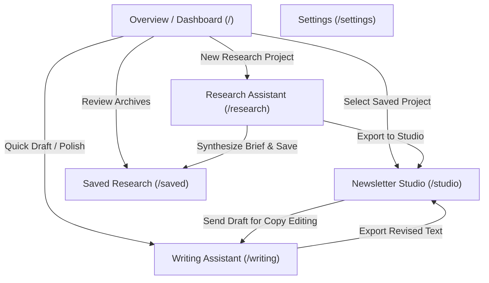

# App Flow Document
## AI Editorial Workspace ("This Week in AI" Edition)

**Document Version:** 1.0.0  
**Status:** Approved for Implementation  
**Role:** Senior UX Strategist & Product Designer  

---

## 1. Global Navigation Architecture

The workspace follows a persistent dual-navigation structure:
- **Left Sidebar:** Primary navigational anchor across all core workspaces.
- **Top Header:** Breadcrumbs, project contextual status, active model indicator, quick actions.

---

## 2. Screen-by-Screen User Journey

### Screen 1: Overview Dashboard (`/`)
- **Header:** "Editorial Command Center", current date, workspace health indicator.
- **Stats Row:** 4 live metric tiles:
  - *Research Projects* (Total saved)
  - *Sources Ingested* (Cumulative verified URLs)
  - *Drafts Polished* (Drafts analyzed in Writing Assistant)
  - *Newsletter Articles* (Generated publication-ready editions)
- **Quick Action Bar:**
  - `[ + New Research Project ]` $\to$ navigates to `/research`
  - `[ Open Writing Editor ]` $\to$ navigates to `/writing`
  - `[ Create Newsletter Draft ]` $\to$ navigates to `/studio`
- **Two-Column Activity Feed:**
  - Left: *Recent Research Projects* with status badges, source counts, and "Open Brief" buttons.
  - Right: *Recent Drafts & Articles* with word counts, readability scores, and "Resume Editing" links.
- **Empty State:** Shows onboarding cards with sample project preloader button ("Load Sample: Claude 3.5 Sonnet vs GPT-4o Launch Analysis").

---

### Screen 2: Research Assistant (`/research`)
- **Primary Objective:** Ingest $\ge 3$ sources, extract readable content, and synthesize an evidence-backed Research Brief.
- **Section 2.1: Source Input Manager**
  - Project Title input (e.g., "DeepSeek R1 Architecture & Market Repercussions").
  - URL Input field with `[ + Add Source URL ]` and quick batch paste modal.
  - Validation Gate: Visual badge displaying:
    - *0 of 3 sources added (Minimum 3 required)* [Red badge]
    - *2 of 3 sources added* [Amber badge]
    - *3 of 3 sources verified — Ready to synthesize* [Emerald badge]
- **Section 2.2: Source Cards Feed**
  - Each source card displays:
    - Favicon & domain badge
    - Extracted Title & canonical URL
    - Extraction Status pill: `Extracted (1,420 words)` [Green] | `Fetching...` [Blue spinner] | `Extraction Failed (Paywall/Blocked)` [Red]
    - Fallback trigger: `[ Edit / Paste Content Manually ]` expands an accessible modal allowing direct text paste.
    - Remove button `[ X ]` with confirmation.
- **Section 2.3: Action Bar**
  - Primary Button: `[ Generate Research Brief ]` (Disabled if $<3$ valid sources).
  - Progress feedback during generation:
    - Step 1: "Validating source integrity..."
    - Step 2: "Cross-referencing factual timelines..."
    - Step 3: "Segregating verified data from speculative hype..."
    - Step 4: "Structuring editorial angles..."
- **Section 2.4: Research Brief Viewer**
  - Rendered when synthesis completes:
    - **Header:** Title, synthesis timestamp, source pills.
    - **Section 1: What Happened?** (Numbered key events with bracketed `[Source X]` citations).
    - **Section 2: Why Does It Matter?** (Macro technological & economic impact).
    - **Section 3: Who Should Care?** (Segmented: AI Engineers, Startup Founders, Enterprise Buyers).
    - **Section 4: Verified Facts vs. Speculation Grid** (Two-column contrast table).
    - **Section 5: Builder Opportunities** (Actionable product avenues).
    - **Section 6: Potential Newsletter Angles** (3 selectable cards: Angle 1, Angle 2, Angle 3).
  - Toolbar:
    - `[ Save Research Project ]`
    - `[ Copy Brief to Clipboard ]`
    - `[ Send to Newsletter Studio -> ]` (passes selected angle to Studio).

---

### Screen 3: Writing Assistant (`/writing`)
- **Primary Objective:** Hemingway-style prose critique, readability metrics, and interactive suggestion acceptance.
- **Layout:** Resizable dual-pane container:
  - **Left Pane (The Canvas):**
    - Document title input.
    - Rich monospace/serif text editor with line numbers and character tracking.
    - Highlighting overlay rendering subtle underlines beneath flagged sentences (Purple = Very Hard, Yellow = Hard, Blue = Passive, Orange = Jargon/Filler).
    - Mode Switcher: `[ Edit Mode ]` vs `[ Diff View: Original vs Revised ]`.
  - **Right Pane (Editorial Inspector):**
    - **Metrics Bar:**
      - Word Count (Target: 300–500 words indicator)
      - Reading Time (~220 wpm)
      - Sentence Count & Avg Sentence Length
      - Readability Level: e.g. "Grade 9.2 (Plain English)" with an info tooltip: *"Readability metrics are calculated as editorial guidance, not a definitive grade."*
    - **Issue Category Filters:**
      - All (8) | Long Sentences (2) | Passive Voice (3) | Jargon & Buzzwords (2) | Fillers (1)
    - **Suggestion Cards Feed:**
      - Card Structure:
        - Category Tag with color coding
        - Original flagged segment
        - Editorial Context: *"Why this matters: This sentence contains 41 words and 3 qualifying clauses, causing cognitive fatigue for newsletter skimmers."*
        - Suggested Rewrite
        - Atomic Buttons:
          - `[ Accept Suggestion ]` (Replaces text directly in the active draft while retaining cursor position).
          - `[ Dismiss ]` (Removes the card from the active review queue).
- **Bottom Bar:**
  - `[ Analyze Draft ]` button
  - `[ Save Draft ]` button
  - `[ Export / Copy Clean Draft ]`

---

### Screen 4: Newsletter Studio (`/studio`)
- **Primary Objective:** Transform research briefs into 300–500 word publication-ready newsletter articles.
- **Workflow Steps:**
  1. **Select Research Brief:** Dropdown / modal to choose from saved research projects.
  2. **Select Newsletter Angle:** Shows the 3+ angles identified in the brief (e.g., "The Open-Source Price Collapse: How Founders Win").
  3. **Editorial Parameters:**
    - Target Word Count: Slider (300 to 500 words, default 400).
    - Tone: "Analytical & Pragmatic" (Default), "Deep Technical Breakdown", or "Executive TL;DR".
  4. **Generate Button:** `[ Generate Newsletter Article ]`.
- **Output Studio Area:**
  - Headline (Editable)
  - Full Draft with standard newsletter scaffolding:
    - Hook / Lede
    - The Core Development
    - Context & Technical Facts
    - The 'So What?' (Builder Implications)
    - Conclusion
    - Sources & Further Reading (Preserved hyperlinks)
  - Word count validator: Live progress indicator showing proximity to 300–500 word editorial target.
  - Integration Action: `[ Send to Writing Assistant for Polish -> ]` (Transfers content directly to `/writing` with one click).

---

### Screen 5: Saved Research Library (`/saved`)
- Filterable and searchable table of all historical research projects.
- Columns: Title, Date, Source Count, Status, Actions (`View Brief`, `Open in Studio`, `Delete`).

---

### Screen 6: Settings (`/settings`)
- Provider selector: Anthropic Claude, OpenAI, or Local Heuristic Engine.
- Custom system prompt adjustments for newsletter voice.
- Data export / backup (JSON download of all projects and drafts).
