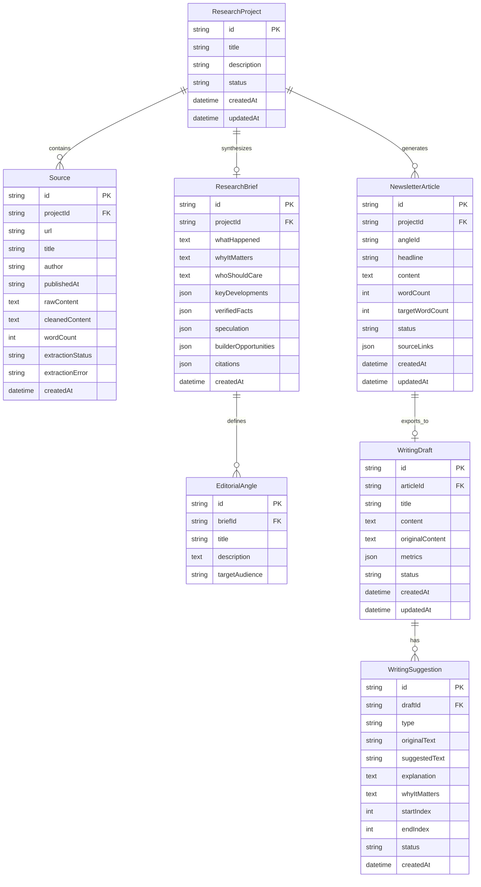

# Backend Schema Document
## AI Editorial Workspace ("This Week in AI" Edition)

**Document Version:** 1.0.0  
**Status:** Approved for Implementation  
**Role:** Senior Backend Engineer & Database Architect  

---

## 1. Relational Entity Relationship Diagram

---

## 2. Table Definitions & Types

### 2.1. `ResearchProject`
Represents an editorial inquiry combining multiple news articles into a unified topic.
- `id` (UUID / CUID, PK)
- `title` (VARCHAR(255), Not Null) - e.g. "DeepSeek V3 Open Weights Impact"
- `description` (TEXT, Nullable) - Summary of research scope
- `status` (ENUM: `'collecting'`, `'analyzing'`, `'completed'`, `'archived'`, Not Null, Default: `'collecting'`)
- `createdAt` (TIMESTAMPTZ, Default: `NOW()`)
- `updatedAt` (TIMESTAMPTZ, Default: `NOW()`)

### 2.2. `Source`
Individual web articles, press releases, or papers ingested for a project.
- `id` (UUID / CUID, PK)
- `projectId` (UUID / CUID, FK $\to$ `ResearchProject.id`, ON DELETE CASCADE)
- `url` (TEXT, Not Null) - Canonical URL
- `title` (VARCHAR(500), Not Null) - Extracted or user-specified title
- `author` (VARCHAR(255), Nullable)
- `publishedAt` (TIMESTAMPTZ, Nullable)
- `rawContent` (TEXT, Nullable) - Full extracted HTML or raw text
- `cleanedContent` (TEXT, Not Null) - Stripped, readable plaintext for LLM ingestion
- `wordCount` (INTEGER, Not Null, Default: 0)
- `extractionStatus` (ENUM: `'pending'`, `'success'`, `'failed'`, `'manual'`, Not Null)
- `extractionError` (TEXT, Nullable) - HTTP error message or paywall note
- `createdAt` (TIMESTAMPTZ, Default: `NOW()`)

### 2.3. `ResearchBrief`
The structured, evidence-backed editorial briefing generated from ingested sources.
- `id` (UUID / CUID, PK)
- `projectId` (UUID / CUID, FK $\to$ `ResearchProject.id`, UNIQUE, ON DELETE CASCADE)
- `whatHappened` (TEXT, Not Null) - Synthesis of the core news event
- `whyItMatters` (TEXT, Not Null) - Macro analysis of structural shift
- `whoShouldCare` (TEXT, Not Null) - Breakdown for engineers, founders, and enterprises
- `keyDevelopments` (JSONB, Not Null) - Array of chronological bullet points: `[{ event: string, sourceIndex: number }]`
- `verifiedFacts` (JSONB, Not Null) - Array of substantiated facts with explicit citations: `[{ fact: string, sourceIndex: number, quote?: string }]`
- `speculation` (JSONB, Not Null) - Array of unverified claims, rumors, or marketing projections: `[{ claim: string, sourceIndex: number, notes: string }]`
- `builderOpportunities` (JSONB, Not Null) - Array of concrete product/infra ideas: `[string]`
- `editorialAngles` (JSONB, Not Null) - Array of minimum 3 newsletter angles: `[{ id: string, title: string, premise: string, targetAudience: string }]`
- `citations` (JSONB, Not Null) - Array of mapped sources: `[{ sourceIndex: number, url: string, title: string }]`
- `createdAt` (TIMESTAMPTZ, Default: `NOW()`)

### 2.4. `NewsletterArticle`
The 300–500 word synthesized newsletter draft ready for publication.
- `id` (UUID / CUID, PK)
- `projectId` (UUID / CUID, FK $\to$ `ResearchProject.id`, ON DELETE SET NULL)
- `angleId` (VARCHAR(100), Nullable) - Corresponding selected angle
- `headline` (VARCHAR(255), Not Null) - Non-clickbait compelling title
- `content` (TEXT, Not Null) - Markdown formatted newsletter draft (Hook, Developments, Context, Builder Takeaways, Sources)
- `wordCount` (INTEGER, Not Null)
- `targetWordCount` (INTEGER, Not Null, Default: 400)
- `status` (ENUM: `'draft'`, `'in_review'`, `'ready'`, `'published'`, Default: `'draft'`)
- `sourceLinks` (JSONB, Not Null) - Mapped hyperlinks for footer citations
- `createdAt` (TIMESTAMPTZ, Default: `NOW()`)
- `updatedAt` (TIMESTAMPTZ, Default: `NOW()`)

### 2.5. `WritingDraft`
A draft actively under copy-editing inside the Writing Assistant.
- `id` (UUID / CUID, PK)
- `articleId` (UUID / CUID, Nullable, FK $\to$ `NewsletterArticle.id`)
- `title` (VARCHAR(255), Not Null)
- `content` (TEXT, Not Null) - Current active text (updates as suggestions are accepted)
- `originalContent` (TEXT, Not Null) - Frozen initial snapshot for diff comparisons
- `metrics` (JSONB, Not Null) - `{ wordCount, charCount, sentenceCount, avgSentenceLength, readingTimeMinutes, fleschReadingEase, fleschKincaidGrade }`
- `status` (ENUM: `'draft'`, `'analyzed'`, `'finalized'`, Default: `'draft'`)
- `createdAt` (TIMESTAMPTZ, Default: `NOW()`)
- `updatedAt` (TIMESTAMPTZ, Default: `NOW()`)

### 2.6. `WritingSuggestion`
Granular copy-editing proposals for a writing draft.
- `id` (UUID / CUID, PK)
- `draftId` (UUID / CUID, FK $\to$ `WritingDraft.id`, ON DELETE CASCADE)
- `type` (ENUM: `'long_sentence'`, `'difficult_sentence'`, `'passive_voice'`, `'jargon'`, `'filler_phrase'`, `'repetition'`, `'complexity'`, Not Null)
- `originalText` (TEXT, Not Null) - Exact sentence or phrase flagged
- `suggestedText` (TEXT, Not Null) - Proposed concise rewrite
- `explanation` (TEXT, Not Null) - Grammatical/stylistic reason
- `whyItMatters` (TEXT, Not Null) - Editorial rationale
- `startIndex` (INTEGER, Not Null) - Character offset in draft
- `endIndex` (INTEGER, Not Null) - Character end offset
- `status` (ENUM: `'pending'`, `'accepted'`, `'rejected'`, Default: `'pending'`)
- `createdAt` (TIMESTAMPTZ, Default: `NOW()`)

---

## 3. Storage Layer Implementation Strategy

To guarantee immediate functionality without mandatory external cloud database configuration, the application implements an **Abstract Repository Pattern** (`EditorialRepository`):

1. **Local JSON Store (`LocalFileStore`):**
   - Stores data atomically in `.data/editorial-store.json`.
   - Uses file locks and synchronous flush mechanisms to prevent partial writes.
   - Automatically seeded with rich default sample research on first launch.
2. **Supabase PostgreSQL Store (`SupabaseStore`):**
   - Automatically activates if `NEXT_PUBLIC_SUPABASE_URL` and `SUPABASE_SERVICE_ROLE_KEY` are provided.
   - Uses PostgreSQL tables with foreign key constraints, indexes on `projectId` and `draftId`, and jsonb indexing.
