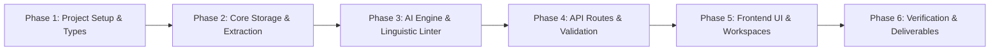

# Implementation Plan
## AI Editorial Workspace ("This Week in AI" Edition)

**Document Version:** 1.0.0  
**Status:** Approved for Implementation  
**Role:** Senior Full Stack Engineer & Technical Project Lead  

---

## 1. Build Sequence Overview

To build a robust, production-grade application without fragmented components or broken states, implementation proceeds through **6 strictly structured phases**:

---

## 2. Phase-by-Phase Plan

### Phase 1: Environment Setup, Configuration & Typing
- **Objective:** Establish the foundation with package manifests, TypeScript configurations, Tailwind theme tokens, and domain types.
- **Deliverables:**
  - `package.json` with stable dependencies (`next`, `react`, `react-dom`, `lucide-react`, `clsx`, `tailwind-merge`, `zod`, `cheerio`, `framer-motion`).
  - `tsconfig.json` with strict type checking and `@/*` path mapping.
  - `tailwind.config.ts` & `postcss.config.mjs` with custom Zinc palette tokens and typography plugin.
  - `src/types/editorial.ts`: Full TypeScript definitions matching the Backend Schema Document.
  - `.env.example` with documented environment keys.

### Phase 2: Core Storage & URL Extraction Services
- **Objective:** Create the persistence and network ingestion layer with bulletproof error handling and SSRF safeguards.
- **Deliverables:**
  - `src/lib/extraction/ssrf-validator.ts`: Comprehensive IP and protocol blacklist validator.
  - `src/lib/extraction/extractor.ts`: Cheerio-based web article scraper with title detection, boilerplate removal, word count calculation, and fallback payload support.
  - `src/lib/db/storage.ts`: Dual-mode storage engine supporting atomic file persistence (`.data/editorial-store.json`) and Supabase PostgreSQL.
  - `src/lib/db/seed-data.ts`: Pre-populated editorial projects (e.g. DeepSeek R1, Claude 3.5 Sonnet Computer Use) for instant evaluation.

### Phase 3: AI Engine & Linguistic Analysis Linter
- **Objective:** Implement the research brief synthesis, newsletter generator, and Hemingway-style writing linter.
- **Deliverables:**
  - `src/lib/analysis/readability.ts`: Mathematical implementation of Flesch Reading Ease and Flesch-Kincaid Grade Level.
  - `src/lib/analysis/heuristics.ts`: Deterministic regex and dictionary linters for long sentences, passive voice, jargon, filler phrases, and repetition.
  - `src/lib/ai/client.ts`: Dual-provider abstraction (Anthropic / OpenAI) with built-in high-fidelity heuristic fallback when API keys are omitted.
  - `src/lib/ai/prompts.ts`: Governed system prompts enforcing strict citation binding, anti-hallucination rules, and facts vs. speculation separation.
  - `src/lib/ai/schemas.ts`: Zod schemas for structured LLM brief and newsletter responses.

### Phase 4: API Routes & Request Validation
- **Objective:** Implement modular Next.js API endpoints with runtime Zod validation and structured error responses.
- **Deliverables:**
  - `/api/dashboard`: Aggregated workspace statistics and activity feeds.
  - `/api/research/extract`: URL extraction endpoint with SSRF checks.
  - `/api/research`: Multi-source synthesis and project persistence ($\ge 3$ sources enforcement).
  - `/api/research/[id]`: Project retrieval and brief lookup.
  - `/api/writing/analyze`: Linguistic inspection and metrics computation.
  - `/api/writing`: Draft persistence and revision management.
  - `/api/studio/generate`: 300–500 word newsletter article synthesis from research briefs.
  - `/api/studio`: Newsletter draft persistence and updates.

### Phase 5: Frontend UI & Interactive Workspaces
- **Objective:** Build the responsive, Linear/Notion-inspired interface with Radix primitives and Framer Motion transitions.
- **Deliverables:**
  - `src/components/layout/app-shell.tsx`: Shared sidebar navigation, top header, breadcrumbs, and status pills.
  - `src/components/ui/*`: Reusable UI components (Button, Input, Textarea, Card, Badge, Tabs, Dialog, Alert, Tooltip).
  - `src/app/page.tsx`: Overview Dashboard with live metrics, quick action triggers, and recent feeds.
  - `src/app/research/page.tsx`: Interactive Research Assistant with $\ge 3$ source gate, real-time extraction feedback, manual fallback editor, and comprehensive Brief Viewer.
  - `src/app/writing/page.tsx`: Hemingway-inspired Writing Assistant with dual-pane layout, real-time metrics, interactive suggestion acceptance, and original/revised diff viewer.
  - `src/app/studio/page.tsx`: Newsletter Studio with research brief connector, angle selector, word-count target tracker, and direct bridge to Writing Assistant.
  - `src/app/saved/page.tsx`: Saved research repository with search and filter.
  - `src/app/settings/page.tsx`: Model provider management and workspace preferences.

### Phase 6: Verification, Polishing & Deliverables
- **Objective:** Thoroughly test every user journey, verify citation integrity, and compile the final submission artifacts.
- **Deliverables:**
  - `README.md`: Comprehensive engineering documentation with architecture, setup, and decisions.
  - `PRODUCT_AND_ENGINEERING_NOTE.md`: Technical trade-offs, citation governance, and architectural rationale.
  - `SAMPLE_EDITORIAL_OUTPUT.md`: Complete 300–500 word sample newsletter article traceable to 3 verified sources.
  - `WRITING_SAMPLE_BEFORE_AFTER.md`: Before-and-after demonstration of the Writing Assistant with itemized accepted suggestions.
