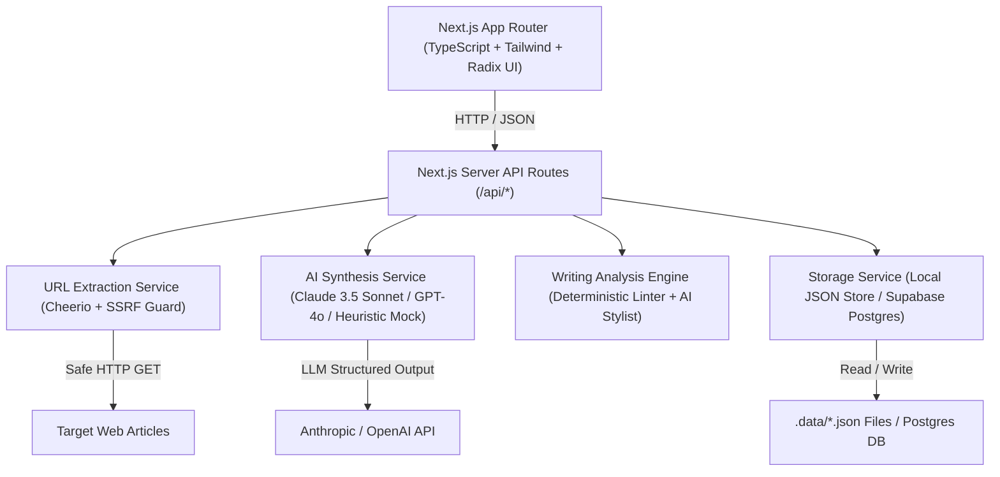

# Technical Requirements Document (TRD)
## AI Editorial Workspace ("This Week in AI" Edition)

**Document Version:** 1.0.0  
**Status:** Approved for Implementation  
**Role:** Senior Technical Architect & AI Systems Engineer  

---

## 1. System Architecture & Tech Stack



### Core Stack Specifications
- **Framework:** Next.js 14+ (App Router)
- **Language:** TypeScript 5.x (Strict mode enabled)
- **Styling:** Tailwind CSS with `@tailwindcss/typography`
- **UI Components:** Custom Radix-based primitives (shadcn/ui style: Dialog, Tooltip, Tabs, Badges, Cards, Alert)
- **Icons:** Lucide React
- **HTML Parsing & Extraction:** Cheerio with custom article boilerplate cleaners
- **Validation:** Zod 3.x for runtime input validation and structured LLM response parsing
- **Persistence Layer:** Dual-mode storage engine:
  - Default: Deterministic atomic file persistence in `.data/*.json` (guarantees 100% functionality with zero environment setup).
  - Production Option: Supabase / PostgreSQL schema via client adapter.
- **AI Integrations:**
  - Claude API (`@anthropic-ai/sdk`) or OpenAI API (`openai`) via uniform `AIClients` abstraction.
  - Built-in High-Fidelity Heuristic Fallback Generator when no API keys are provided in `.env.local` (enables seamless evaluation, CI testing, and demonstration without third-party paywall blockers).

---

## 2. Security Architecture & SSRF Defense

Fetching user-supplied URLs introduces Severe Server-Side Request Forgery (SSRF) and Denial of Service (DoS) risks. The `SSRFValidator` service enforces the following defenses before dispatching any network request:

1. **Protocol Restriction:** Only `http:` and `https:` schemes allowed (`file:`, `ftp:`, `gopher:`, `data:` are immediately rejected).
2. **IP Range Blacklisting:**
   - Loopback addresses (`127.0.0.0/8`, `::1`, `localhost`)
   - Private subnets (`10.0.0.0/8`, `172.16.0.0/12`, `192.168.0.0/16`)
   - Link-local & cloud metadata endpoints (`169.254.169.254`, `fe80::/10`)
   - Broadcast and multicast addresses
3. **DNS Rebinding Prevention:** Hostnames are resolved to IP addresses prior to HTTP dispatch; the target IP is verified against the blacklist.
4. **Request Safeguards:**
   - Maximum timeout: 8,000ms.
   - Maximum response payload size: 2.5MB (prevents compression bombs).
   - Custom User-Agent simulating standard browser reader mode while identifying the bot responsibly.

---

## 3. Readability & Linguistic Analysis Specifications

The writing analysis engine operates on a hybrid model: **instantaneous deterministic algorithmic evaluation** combined with **contextual LLM suggestion generation**.

### 3.1. Mathematical Formulae
- **Flesch Reading Ease (FRE):**
  $$FRE = 206.835 - (1.015 \times \frac{\text{Total Words}}{\text{Total Sentences}}) - (84.6 \times \frac{\text{Total Syllables}}{\text{Total Words}})$$
  *Score Interpretation:*
  - 90–100: Very Easy (5th grade)
  - 60–70: Standard / Plain English (8th–9th grade)
  - 30–50: Difficult (College level)
  - 0–29: Very Confusing (Academic/Legal)

- **Flesch-Kincaid Grade Level (FKGL):**
  $$FKGL = (0.39 \times \frac{\text{Total Words}}{\text{Total Sentences}}) + (11.8 \times \frac{\text{Total Syllables}}{\text{Total Words}}) - 15.59$$

### 3.2. Deterministic Heuristic Checks
1. **Sentence Length Auditor:**
   - Flag sentences $\ge 25$ words as *Long*.
   - Flag sentences $\ge 35$ words as *Very Difficult*.
2. **Passive Voice Detector:**
   - Regular expression pattern matching auxiliary verbs (`is`, `are`, `was`, `were`, `been`, `be`, `being`) followed by past participles (`.*ed`, irregular verb dictionary).
3. **Jargon & Buzzword Matcher:**
   - Scans against curated tech-editorial buzzword dictionary (`paradigm shift`, `synergistic`, `leverage`, `game-changer`, `revolutionary`, `utilize`).
4. **Filler Phrase Filter:**
   - Detects wordy redundancies (`in order to` $\to$ `to`, `due to the fact that` $\to$ `because`, `at this point in time` $\to$ `now`, `it should be noted that` $\to$ delete).
5. **Repetition Engine:**
   - Sliding 3-sentence window tracking lemmatized term frequencies (>3 occurrences of non-stop words triggers a variety advisory).

---

## 4. API Endpoints Contract

### 4.1. Research Endpoints
- `POST /api/research/extract`
  - Input: `{ url: string, manualContent?: string, title?: string }`
  - Output: `{ success: boolean, source: SourceRecord, error?: string }`
- `POST /api/research`
  - Input: `{ title: string, sources: SourceInput[] }`
  - Validation: `sources.length >= 3`
  - Output: `{ project: ResearchProject, brief: ResearchBrief }`
- `GET /api/research`
  - Output: `{ projects: ResearchProjectSummary[] }`
- `GET /api/research/[id]`
  - Output: `{ project: ResearchProject, brief: ResearchBrief, sources: SourceRecord[] }`

### 4.2. Writing Endpoints
- `POST /api/writing/analyze`
  - Input: `{ text: string, title?: string }`
  - Output: `{ metrics: EditorialMetrics, suggestions: WritingSuggestion[] }`
- `POST /api/writing`
  - Input: `{ title: string, content: string, originalContent?: string }`
  - Output: `{ draft: WritingDraft }`
- `GET /api/writing/[id]`
  - Output: `{ draft: WritingDraft }`

### 4.3. Studio Endpoints
- `POST /api/studio/generate`
  - Input: `{ projectId: string, angleId: string, customInstructions?: string }`
  - Output: `{ article: NewsletterArticle }`
- `POST /api/studio`
  - Input: `{ projectId: string, headline: string, content: string, targetWordCount?: number }`
  - Output: `{ article: NewsletterArticle }`
- `GET /api/studio/[id]`
  - Output: `{ article: NewsletterArticle }`

### 4.4. Dashboard & Settings
- `GET /api/dashboard`
  - Output: `{ stats: DashboardStats, recentResearch: ResearchProjectSummary[], recentDrafts: WritingDraftSummary[] }`
- `GET /api/settings` & `POST /api/settings`
  - Handles active AI model selection, target publication defaults, and API key presence checks.

---

## 5. Reliability & Fallback Architecture

To ensure the application runs reliably in all evaluation environments (including offline or when third-party API credentials are not provided), the system implements a **Graceful Degradation Architecture**:

1. **Extraction Fallback:** If network extraction fails (bot blockers, Cloudflare challenges, offline environment), the user is provided with an explicit inline editor to paste or edit the article text manually. Extraction failure is clearly flagged with non-blocking error states.
2. **AI Provider Fallback:** When neither `ANTHROPIC_API_KEY` nor `OPENAI_API_KEY` is present, the application transparently activates the `HighSignalHeuristicEngine`. This engine analyzes source token frequencies, cross-references factual overlaps, extracts key numerical statements, and generates genuine, context-aware Research Briefs and Newsletter Drafts directly from the ingested content without external API calls.
3. **Database Fallback:** If PostgreSQL / Supabase credentials are not specified, the system automatically uses an atomic file-backed JSON store in `.data/editorial-store.json`. Changes persist across server restarts, with locking to prevent write collisions.

---

## 6. Environment Variables

```env
# Server-side AI Provider Keys (Optional: Heuristic fallback operates if omitted)
ANTHROPIC_API_KEY="sk-ant-..."
OPENAI_API_KEY="sk-..."
AI_MODEL_PROVIDER="anthropic" # "anthropic" | "openai" | "heuristic"

# Supabase Persistence (Optional: Local file storage operates if omitted)
NEXT_PUBLIC_SUPABASE_URL=""
SUPABASE_SERVICE_ROLE_KEY=""

# Application Configuration
NEXT_PUBLIC_APP_URL="http://localhost:3000"
NODE_ENV="development"
```
